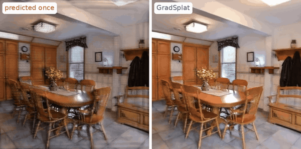
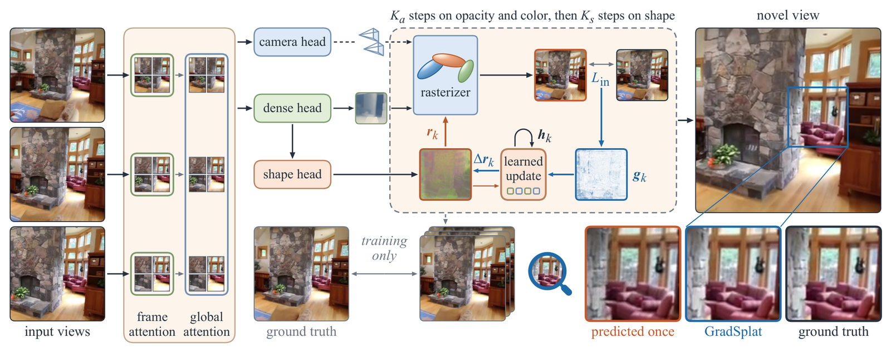
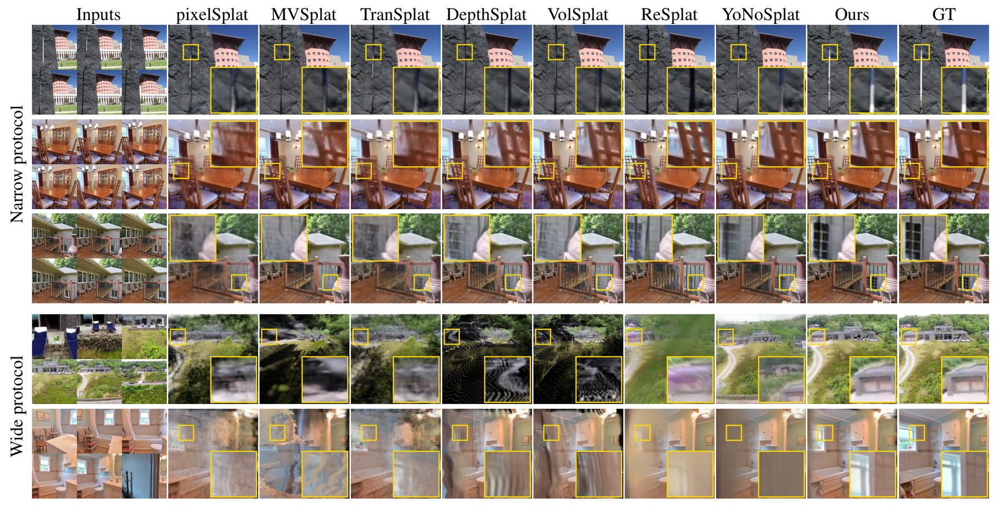
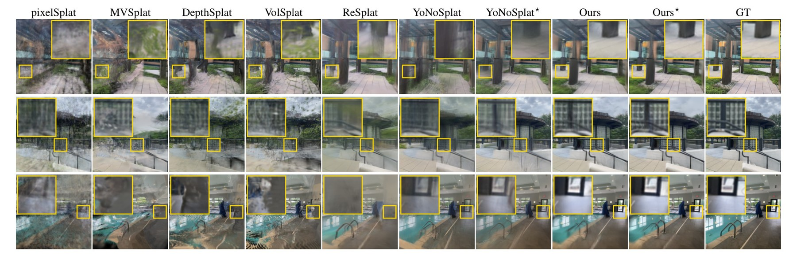
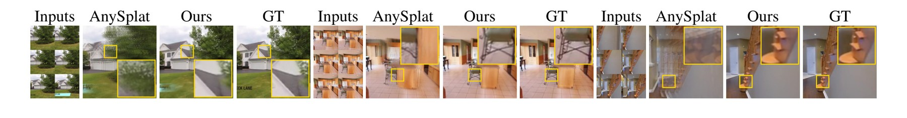

<div align="center">

# GradSplat: Gradients Inside the Forward Pass for Feed-Forward 3D Gaussian Splatting

**Jingong Chen**<sup>1,2</sup> · **Linlian Jiang**<sup>3,4†</sup> · **Guangyuan Li**<sup>5,2†</sup> · **Xinxin Zuo**<sup>3</sup> · **Yang Wang**<sup>3,4</sup> · **Chulwoo Pack**<sup>1</sup> · **Kyle Gao**<sup>2</sup> · **Kwanghee Won**<sup>1*</sup>

<sup>1</sup>South Dakota State University &nbsp; <sup>2</sup>Aalto University &nbsp; <sup>3</sup>Concordia University<br>
<sup>4</sup>Mila – Quebec AI Institute &nbsp; <sup>5</sup>ELLIS Institute Finland<br>
<sup>†</sup>Equal contribution &nbsp; <sup>*</sup>Corresponding author

<a href="https://jingong-chen.github.io/GradSplat/"></a> <a href="https://arxiv.org/abs/2610.38951"></a> <a href="https://huggingface.co/Jingong/GradSplat"></a> <a href="LICENSE"></a> <a href="gradsplat/_vggt_omega/LICENSE"></a>



</div>

**GradSplat** reconstructs a scene as 3D Gaussians from a few images in one forward pass, and refines its own prediction inside that pass. It renders the predicted Gaussians into the **input views**, backpropagates the photometric error through the rasterizer, and applies the gradient with a **learned recurrent update**, first to opacity and color and then to the shape of the Gaussians. The steps read only the input views, so they run unchanged at inference, and GradSplat remains a feed-forward model.

## News

- **2026-11-01** · Inference code, model weights, demos and evaluation code are released.

## Contents

[Highlights](#highlights) · [Installation](#installation) · [Quick start](#quick-start) · [Demos](#demos) · [Models](#models) · [Results](#results) · [Evaluation](#evaluation) · [Citation](#citation)

## Highlights

- **Gradient steps inside the model.** Three appearance steps and five shape steps. Each renders the Gaussians into the input views, takes the gradient of the mean squared error through the rasterizer and turns it into an update with a learned network. The steps are unrolled in training and use no target view.
- **Log-anisotropy correction.** The shape steps act on the axis ratios of every Gaussian in log space, at constant volume, and on a rotation increment.
- **One model for 6 to 42 views.** On both complete six-view RealEstate10K protocols GradSplat has the best PSNR and SSIM among nine methods, and it keeps its accuracy as views are added. Without fine-tuning it is the most accurate on DL3DV and has the best PSNR and SSIM on ScanNet++.
- **Cameras are optional.** With the cameras of the views the Gaussians are placed in their frame and scale. Without them GradSplat uses its own predicted cameras, at lower accuracy.

<p align="center"></p>

A VGGT-Ω backbone with frame and global attention feeds a camera head, a dense head and a shape head. The dense head predicts a depth and the raw parameters of one Gaussian for every input pixel. Each refinement step renders the Gaussians into the input views and applies the learned update to the gradient of the input-view loss, first on opacity and color and then on the shape.

## Installation

```bash
git clone https://github.com/Jingong-Chen/GradSplat.git
cd GradSplat
conda create -n gradsplat python=3.10 -y && conda activate gradsplat
pip install torch torchvision --index-url https://download.pytorch.org/whl/cu128   # pick the build for your CUDA
pip install -e .              # gradsplat and the gsplat rasterizer
pip install -e ".[demo]"      # optional: Gradio demo
pip install -e ".[eval]"      # optional: evaluation (LPIPS)
```

GradSplat needs a CUDA GPU: the refinement steps rasterize the Gaussians with [gsplat](https://github.com/nerfstudio-project/gsplat). gsplat builds its CUDA code on the first run, which needs the CUDA toolkit of your PyTorch build; it also provides precompiled wheels for some Python, PyTorch and CUDA versions (see its README). The weights (4.9 GB) are downloaded from Hugging Face on first use. The released code was tested with PyTorch 2.11 (CUDA 12.8) and gsplat 1.5.3.

## Quick start

```python
from gradsplat import GradSplat
from gradsplat.io import load_views

model = GradSplat.from_pretrained("Jingong/GradSplat").to("cuda").eval()

# views are center-cropped and resized to 224 x 224; cameras are optional
views = load_views("examples/re10k_dining_room/images", cameras="examples/re10k_dining_room/cameras.json")
out = model.infer(views.images, views.c2w, views.K)     # without cameras: model.infer(views.images)

g = out["gaussians"]          # one Gaussian per input pixel, N = V x 224 x 224:
                              # means (1, N, 3), scales (1, N, 3), quats (1, N, 4), opacities (1, N), sh (1, N, 4, 3)
colors, depths = model.render(g, out["c2w"], out["K"])  # render cameras (1, T, 4, 4) with pixel intrinsics (1, T, 3, 3)
```

Cameras are camera-to-world matrices with OpenCV axes (x right, y down, z forward) and pixel intrinsics, expressed in the frame of the first view. With cameras, the scene takes their scale. Without them, the predicted cameras are used and their translations and the depth are multiplied by a constant κ = 4.04, calibrated on RealEstate10K (`model.cfg.kappa`, or `depth_scale=` in `forward`). `return_iterates=True` also returns the Gaussians before the steps and after every step. `gradsplat.export` writes PLY files in the format of 3D Gaussian Splatting and renders videos along camera paths.

## Demos

**Command line.** Three RealEstate10K test scenes ship with the code:

```bash
# with the cameras of the views, as in the paper's main results
python demo.py --images examples/re10k_dining_room/images --cameras examples/re10k_dining_room/cameras.json --out outputs/dining_room

# without cameras: GradSplat predicts them
python demo.py --images examples/re10k_rock/images --out outputs/rock

# your own images or a video
python demo.py --images my_scene/ --out outputs/my_scene
python demo.py --video my_video.mp4 --num-frames 6 --out outputs/my_video
```

Each run writes `gaussians.ply`, `video.mp4` (a path through the input cameras), `steps.jpg` (one novel view as predicted, after the appearance steps and after the shape steps) and `cameras.json`. The model was trained with 2 to 12 views of 224 × 224 pixels per scene; views should overlap, as frames of one video do.

**Interactive.** `python demo_gradio.py` opens a browser app: upload images or a video, optionally with `cameras.json`, and inspect the 3D Gaussians, the rendered video and the effect of the steps. The examples load with one click.

## Models

Both weights are in [🤗 Jingong/GradSplat](https://huggingface.co/Jingong/GradSplat).

| Training data | File | Load with |
|:---|:---|:---|
| RealEstate10K | `model.safetensors` | `GradSplat.from_pretrained("Jingong/GradSplat")` |
| RealEstate10K, then 12,000 steps on DL3DV | `model.dl3dv.safetensors` | `GradSplat.from_pretrained("Jingong/GradSplat", variant="dl3dv")` |

Both have 1.22 B parameters and take views of 224 × 224 pixels. GradSplat is initialized from VGGT-Ω and trained for 178,000 steps in four stages on the training split of RealEstate10K, with 2 to 12 input views per sample. `demo.py` and `eval/evaluate.py` take `--variant dl3dv` for the DL3DV weights.

## Results

All numbers are from the paper and every method is re-measured under one setting with released weights. The best value of a column is in **bold** and the second <ins>underlined</ins>, per block.

### RealEstate10K

<p align="center"></p>

The upper three rows are scenes of the narrow protocol and the lower two scenes of the wide protocol. Each row shows the six input views, one target view rendered by every method and the ground truth; the boxed region is magnified in the opposite corner.

Six input views and eight target views per scene, at 224 × 224 pixels. The narrow protocol uses the index released with VolSplat (7,128 scenes) and the wide protocol the index released with YoNoSplat (1,600 scenes). The right block adds input views to the fixed targets of the narrow protocol (6,444 scenes).

| Method | Narrow PSNR ↑ | SSIM ↑ | LPIPS ↓ | Wide PSNR ↑ | SSIM ↑ | LPIPS ↓ | V = 6 | 12 | 24 | 32 | 42 |
|:---|:---:|:---:|:---:|:---:|:---:|:---:|:---:|:---:|:---:|:---:|:---:|
| pixelSplat | 29.143 | 0.9141 | 0.1773 | 19.748 | 0.6239 | 0.4594 | 28.968 | × | × | × | × |
| MVSplat | 30.140 | 0.9418 | 0.0774 | 20.983 | 0.7566 | 0.2542 | 29.954 | 28.059 | 26.666 | 26.379 | 26.009 |
| TranSplat | 30.464 | 0.9296 | 0.1454 | 19.849 | 0.6489 | 0.4265 | 30.289 | × | × | × | × |
| DepthSplat | <ins>31.418</ins> | <ins>0.9524</ins> | <ins>0.0656</ins> | 23.018 | 0.8270 | 0.1937 | <ins>31.241</ins> | 29.318 | 26.978 | 26.533 | 25.594 |
| VolSplat | 31.243 | <ins>0.9524</ins> | <ins>0.0656</ins> | 23.042 | 0.8217 | 0.2069 | 31.120 | 29.285 | 26.936 | 26.676 | 25.829 |
| ReSplat§ | 29.139 | 0.9272 | 0.0915 | 24.681 | 0.8722 | 0.1471 | 28.995 | 27.419 | 24.559 | 24.415 | 23.675 |
| YoNoSplat | 30.500 | 0.9390 | 0.0729 | <ins>25.707</ins> | <ins>0.8779</ins> | **0.1295** | 30.544 | <ins>31.038</ins> | <ins>31.233</ins> | <ins>31.199</ins> | <ins>31.183</ins> |
| **GradSplat** | **33.683** | **0.9593** | **0.0640** | **26.755** | **0.8993** | <ins>0.1301</ins> | **33.636** | **34.631** | **34.401** | **34.382** | **34.801** |
| *Without input poses* | | | | | | | | | | | |
| AnySplat‡ | 19.629 | 0.6160 | 0.2949 | 15.525 | 0.4250 | 0.4414 | 19.523 | 20.226 | 20.397 | 20.500 | 20.592 |
| YoNoSplat† | **27.816** | **0.8982** | **0.0848** | **21.861** | **0.7310** | **0.1868** | **27.921** | <ins>28.063</ins> | <ins>28.046</ins> | <ins>27.832</ins> | <ins>27.848</ins> |
| **GradSplat** | <ins>26.914</ins> | <ins>0.8863</ins> | <ins>0.1053</ins> | <ins>20.901</ins> | <ins>0.6945</ins> | <ins>0.2426</ins> | <ins>26.792</ins> | **28.896** | **30.098** | **30.517** | **31.007** |

In the lower block AnySplat and GradSplat also estimate the intrinsics and the target cameras, GradSplat with the constant κ, and YoNoSplat† keeps the ground-truth intrinsics and target cameras. § marks two-view weights, ‡ a training mixture that contains DL3DV and not RealEstate10K, and × weights whose view embedding holds six views and cannot take more. Below six views GradSplat scores 28.492, 31.490 and 32.501 dB at V = 2, 3 and 4 on the same 6,444 scenes.

### Transfer to DL3DV and ScanNet++

<p align="center"></p>

DL3DV with RealEstate10K weights; ⋆ marks weights trained on DL3DV.

| Method | DL3DV PSNR ↑ | SSIM ↑ | LPIPS ↓ | ScanNet++ PSNR ↑ | SSIM ↑ | LPIPS ↓ |
|:---|:---:|:---:|:---:|:---:|:---:|:---:|
| pixelSplat | 17.309 | 0.4671 | 0.5580 | 20.889 | 0.7038 | 0.4163 |
| MVSplat | 17.390 | 0.5362 | 0.4256 | 18.511 | 0.6804 | 0.3411 |
| TranSplat | 16.964 | 0.4783 | 0.5388 | <ins>21.458</ins> | 0.7225 | 0.3919 |
| DepthSplat | 20.023 | 0.6740 | 0.3248 | 17.791 | 0.6803 | 0.3249 |
| VolSplat | 19.813 | 0.6579 | 0.3425 | 18.745 | 0.7033 | 0.3295 |
| ReSplat§ | 21.144 | 0.7492 | 0.2449 | 20.972 | <ins>0.7523</ins> | **0.3074** |
| YoNoSplat | <ins>22.794</ins> | <ins>0.7694</ins> | <ins>0.2107</ins> | – | – | – |
| AnySplat‡ | 15.122 | 0.3390 | 0.4803 | 13.509 | 0.4368 | 0.5203 |
| **GradSplat** | **24.787** | **0.8448** | **0.1919** | **21.609** | **0.7540** | <ins>0.3184</ins> |
| *Trained on DL3DV* | | | | | | |
| YoNoSplat | 24.783 | 0.8466 | **0.1469** | – | – | – |
| **GradSplat** | **26.104** | **0.8802** | 0.1505 | – | – | – |

The upper block applies the RealEstate10K weights without fine-tuning: 139 of the 140 scenes of the DL3DV index released with ReSplat (six input and eight target views) and the validation set of ScanNet++ (six input and three target views, index built in this work). YoNoSplat is not evaluated on ScanNet++, since its input views rendered back score 13.733 dB there and the setting requires 20 dB. ‡ here marks a training mixture that contains DL3DV and ScanNet++ and not RealEstate10K.

### Without input poses

<p align="center"></p>

Three scenes of the narrow protocol with their input views, one target view rendered by AnySplat and by GradSplat, and the ground truth; neither method receives the input poses.

## Evaluation

[`eval/`](eval/README.md) reproduces the GradSplat rows of the tables above from the released weights: data preparation, the evaluation indices of the paper (`assets/indices/`), and one command per protocol.

```bash
pip install -e ".[eval]"
python eval/evaluate.py --protocol re10k_narrow --data data/re10k --out results/re10k_narrow --compare-paper
python eval/evaluate.py --protocol re10k_wide --data data/re10k --pose-free --out results/re10k_wide_posefree --compare-paper
python eval/evaluate.py --protocol dl3dv --data data/dl3dv --variant dl3dv --out results/dl3dv_ft --compare-paper
```

## Citation

```bibtex
@article{chen2026gradsplat,
  title   = {GradSplat: Gradients Inside the Forward Pass for Feed-Forward 3D Gaussian Splatting},
  author  = {Chen, Jingong and Jiang, Linlian and Li, Guangyuan and Zuo, Xinxin and
             Wang, Yang and Pack, Chulwoo and Gao, Kyle and Won, Kwanghee},
  journal = {arXiv preprint arXiv:2610.38951},
  year    = {2026}
}
```

## Acknowledgments

GradSplat builds on [VGGT-Ω](https://github.com/facebookresearch/vggt-omega), whose network and weights initialize our backbone, camera head and dense head, and on [VGGT](https://github.com/facebookresearch/vggt). Gaussians are rasterized with [gsplat](https://github.com/nerfstudio-project/gsplat). We train on [RealEstate10K](https://google.github.io/realestate10k/) in the format released by [pixelSplat](https://github.com/dcharatan/pixelsplat) and evaluate on [DL3DV](https://github.com/DL3DV-10K/Dataset) and [ScanNet++](https://kaldir.vc.in.tum.de/scannetpp/), with the evaluation indices released with [VolSplat](https://github.com/ziplab/VolSplat), [YoNoSplat](https://github.com/cvg/yonosplat) and [ReSplat](https://github.com/cvg/resplat). We thank the authors of [pixelSplat](https://github.com/dcharatan/pixelsplat), [MVSplat](https://github.com/donydchen/mvsplat), [TranSplat](https://github.com/xingyoujun/transplat), [DepthSplat](https://github.com/cvg/depthsplat), [VolSplat](https://github.com/ziplab/VolSplat), [ReSplat](https://github.com/cvg/resplat), [YoNoSplat](https://github.com/cvg/yonosplat) and [AnySplat](https://github.com/InternRobotics/AnySplat) for releasing the code and weights we compare against. The example scenes are from the RealEstate10K test set.

This work was supported by the U.S. National Science Foundation under Grant No. 2316400. The authors also acknowledge the South Dakota State University High Performance Computing (SDSU HPC) team for providing access to and support for the university's high-performance computing resources. We acknowledge CSC – IT Center for Science, Finland, for providing access to Roihu and to LUMI, which is owned by the EuroHPC Joint Undertaking and hosted by CSC – IT Center for Science, Finland, in collaboration with the LUMI consortium.

## License

The GradSplat code is released under the [MIT License](LICENSE). The code of VGGT-Ω in `gradsplat/_vggt_omega/`, the two files that adapt it (`gradsplat/heads.py` and `gradsplat/model.py`) and the weights, which are trained from the VGGT-Ω weights, are under the [FAIR Noncommercial Research License](gradsplat/_vggt_omega/LICENSE) of VGGT-Ω, for noncommercial research use. The evaluation indices come from repositories under the MIT License, and the example images keep the terms of their dataset; see [THIRD_PARTY_NOTICES.md](THIRD_PARTY_NOTICES.md).
